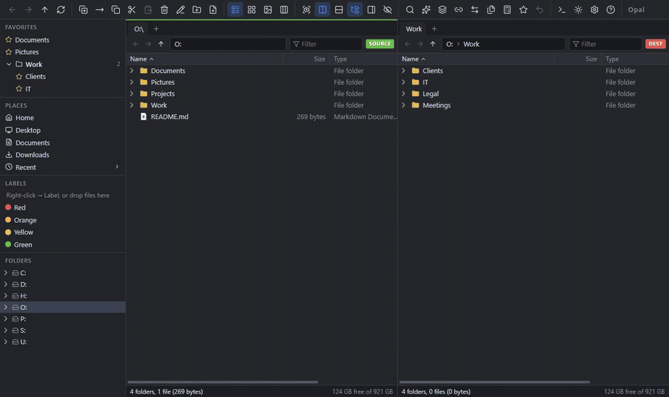
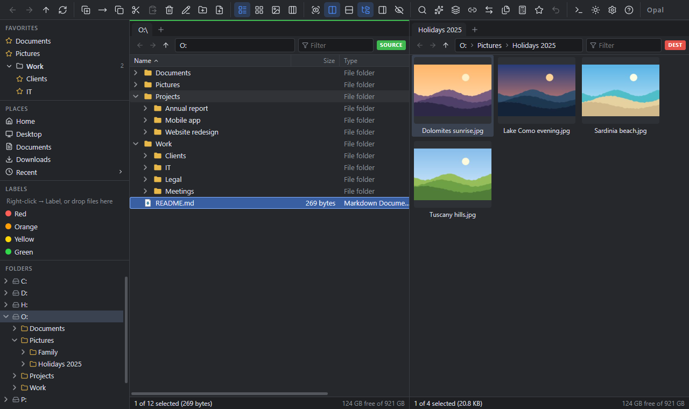
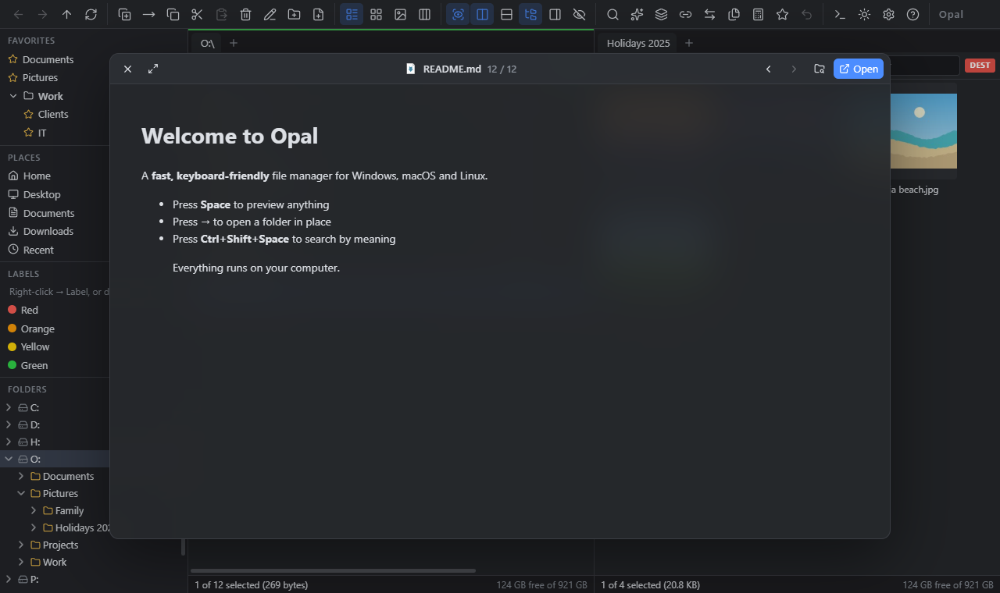
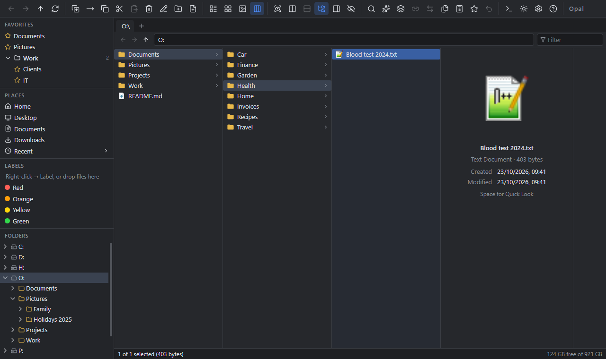
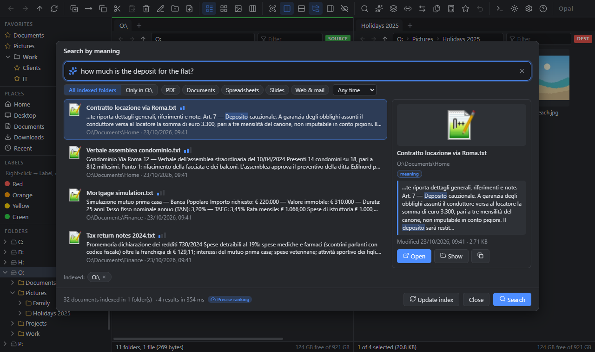
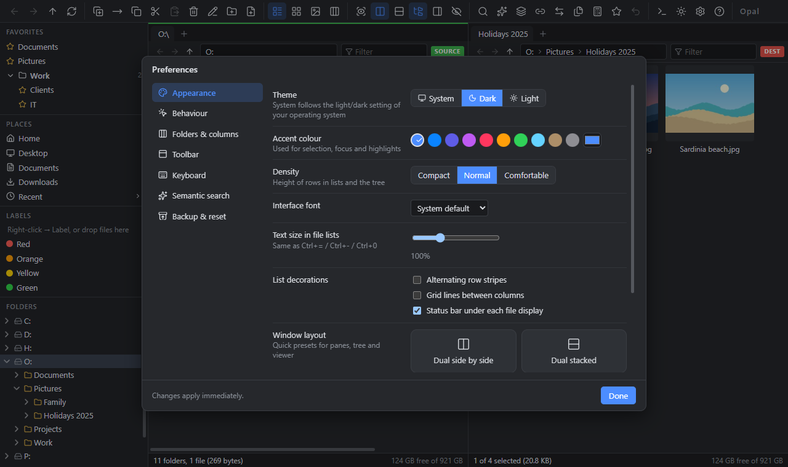

<p align="center">
  
</p>

<h1 align="center">Opal</h1>

<p align="center">
  <b>A fast, keyboard-friendly dual-pane file manager for Windows, macOS and Linux.</b><br>
  Tabs · folders that expand in place · Quick Look on Space · Finder-style columns · batch rename · sync & duplicates ·
  <b>search your documents by meaning</b> — locally, privately.
</p>

<p align="center">
  <a href="https://github.com/enprevo/opal/actions/workflows/ci.yml"></a>
  <a href="LICENSE"></a>
  
</p>

<p align="center">
  
</p>

Opal is a file manager for people who live in their folders: two panes, tabs, a real keyboard workflow, and a few
things you don't usually get — previews on <kbd>Space</kbd>, folders that open in place like a tree, and a search that
understands what your documents are *about*, without sending anything to the cloud.



## Highlights

| | |
| --- | --- |
| **Dual pane, tabs, tree** | Source/destination panes side by side or stacked, tabs with undo-close, folder tree with keyboard navigation, breadcrumbs, favorites in collapsible groups, recent places, multiple windows, Navigation Lock, mouse back/forward buttons. |
| **Expandable folders** | In Details view folders open in place like a tree: <kbd>→</kbd> expands, <kbd>←</kbd> collapses or jumps to the parent. Copying nested items asks whether to recreate the structure. |
| **Quick Look** | Press <kbd>Space</kbd> for a large preview — images, video, audio, PDF, rendered Markdown, code with line numbers, archive contents, folder sizes — and use the arrow keys to flip through files. |
| **Column view** | Finder-style Miller columns with a preview column. |
| **Semantic search** | “invoice for the boiler repair” finds *fattura manutenzione caldaia*. Two small multilingual AI models run **on your computer**: one finds candidates by meaning, the other re-reads them to rank precisely, combined with keyword ranking. PDF, Word, Excel, PowerPoint, OpenDocument, RTF, EPUB, e-mail, web pages, text and Markdown (code optionally). |
| **Sort, group, columns** | Name, extension, size, type, dates, location, labels, image dimensions, item count. Group by kind, type, date, size, name or label. Drag columns to reorder, double-click to autosize. View, sorting and grouping are remembered per folder. |
| **Colour labels** | Tag files with colours (<kbd>Ctrl</kbd>+<kbd>Alt</kbd>+<kbd>1…7</kbd>), show them as a column, group by them, and list everything with a label from the sidebar. |
| **Helper cards** | Hover any button, menu item, column or file: a card explains it *beside* the item, never on top of it. File infotips show kind, size, dates and dimensions. |
| **Safe file operations** | Copy and move with progress, cancel and conflict policies (skip, keep both, replace if newer, replace); temp-file writes so a failed copy never destroys the original; undo for rename, move, copy and create. |
| **Power tools** | Advanced batch rename (wildcards, regex, numbering, case, date macros, presets), Find, Synchronize folders, Duplicate finder, Split/Join, checksums, Flat View, a command line (`>`) with a small command language, and editable hotkeys. |
| **Make it yours** | Light/dark/system theme, accent colour, density, fonts, stripes and grid lines, custom toolbar, standard or Commander-style keys, layout presets, startup folders, and a first-run setup assistant. Every setting can be exported and imported, across Windows, macOS and Linux. |

<table>
  <tr>
    <td></td>
    <td></td>
  </tr>
  <tr>
    <td></td>
    <td></td>
  </tr>
</table>

## Install

Download the latest installer from the [Releases](https://github.com/enprevo/opal/releases) page. Every package is
built natively for its CPU (x64 and ARM64), so the local AI model runs at full speed everywhere.

| OS | Package | Notes |
| --- | --- | --- |
| **Windows 10/11** | `Opal-x.y.z-win-x64.exe` (installer), `…-portable.exe`, `…-win-arm64.exe` | SmartScreen may warn because the build is not code-signed yet: *More info → Run anyway*. |
| **macOS 12+** | `Opal-x.y.z-mac-arm64.dmg` (Apple Silicon), `Opal-x.y.z-mac-x64.dmg` (Intel) | Not notarized yet: the first time, right-click Opal → **Open**, or run `xattr -dr com.apple.quarantine /Applications/Opal.app`. |
| **Ubuntu / Debian** | `Opal-x.y.z-linux-x64.deb`, `…-arm64.deb` | Recommended on Ubuntu: `sudo apt install ./Opal-*.deb` |
| **Other Linux** | `.AppImage`, `.rpm` | AppImage needs FUSE 2 (`sudo apt install libfuse2t64` on Ubuntu 24.04). On Ubuntu 23.10+ Opal disables the Chromium sandbox automatically when run as an AppImage (AppArmor restriction); the `.deb` keeps it. |

## Keyboard

Two keymaps are included (switch in **Preferences → Keyboard**); every key can be re-bound. <kbd>Ctrl</kbd> is <kbd>⌘</kbd> on macOS,
where Finder conventions are added on top: <kbd>⌘</kbd>+<kbd>⌫</kbd> moves to the trash, <kbd>⌘</kbd>+<kbd>↑</kbd>/<kbd>↓</kbd> go up/open,
<kbd>⌘</kbd>+<kbd>[</kbd>/<kbd>]</kbd> back/forward, <kbd>⌘</kbd>+<kbd>⇧</kbd>+<kbd>.</kbd> shows hidden files and <kbd>⌘</kbd>+<kbd>⇧</kbd>+<kbd>G</kbd> types a path.

| Key | Action | Key | Action |
| --- | --- | --- | --- |
| <kbd>Space</kbd> | Quick Look | <kbd>Shift</kbd>+<kbd>Space</kbd> / <kbd>Insert</kbd> | Toggle selection |
| <kbd>→</kbd> / <kbd>←</kbd> | Expand / collapse folder in place | <kbd>Enter</kbd> | Open |
| <kbd>Ctrl</kbd>+<kbd>1</kbd> / <kbd>2</kbd> / <kbd>3</kbd> | Copy / move to other pane / batch rename | <kbd>F2</kbd> | Rename |
| <kbd>Tab</kbd> | Switch source / destination | <kbd>Backspace</kbd> | Parent folder |
| <kbd>Ctrl</kbd>+<kbd>T</kbd> / <kbd>W</kbd> / <kbd>Shift</kbd>+<kbd>W</kbd> | New / close / reopen tab | <kbd>Ctrl</kbd>+<kbd>PgUp</kbd>/<kbd>PgDn</kbd> | Previous / next tab |
| <kbd>Ctrl</kbd>+<kbd>F</kbd> | Find | <kbd>Ctrl</kbd>+<kbd>Shift</kbd>+<kbd>Space</kbd> | Search by meaning |
| <kbd>Alt</kbd>+<kbd>←</kbd> / <kbd>→</kbd>, mouse side buttons | Back / forward | <kbd>Ctrl</kbd>+<kbd>D</kbd> | Add / remove favorite |
| <kbd>Ctrl</kbd>+<kbd>Shift</kbd>+<kbd>5</kbd> (macOS: <kbd>⌘</kbd>+<kbd>⌥</kbd>+<kbd>3</kbd>) | Column view | <kbd>Ctrl</kbd>+<kbd>Alt</kbd>+<kbd>1…7</kbd> | Colour labels |
| <kbd>F6</kbd> / <kbd>F7</kbd> / <kbd>F8</kbd> | Dual pane / viewer / tree | <kbd>Ctrl</kbd>+<kbd>Z</kbd> | Undo |
| <kbd>></kbd> | Command line | <kbd>F1</kbd> | All commands and keys |

## Semantic search

Click **✦ Ask** in the toolbar (or press <kbd>Ctrl</kbd>+<kbd>Shift</kbd>+<kbd>Space</kbd>), choose the folders to
index, and describe what you are looking for, in any language. Results appear while you type, with the matching
passage highlighted, the page number for PDFs, and filters for type, date and folder.

How it works, all on your computer:

1. **Indexing** runs in a separate background process, newest files first, so the file manager never slows down.
   Documents are split into passages; tables of numbers, logs and code are left out of the AI part (code can be
   included in Preferences), copies of the same file are indexed once, and every passage carries its file title.
2. **Finding**: [`multilingual-e5-small`](https://huggingface.co/Xenova/multilingual-e5-small) (≈120 MB) matches the
   meaning of your words to the passages, and a BM25 keyword index catches exact names, codes and word forms
   (*fattura* / *fatture*).
3. **Ranking**: a cross-encoder ([`mmarco-mMiniLMv2`](https://huggingface.co/cross-encoder/mmarco-mMiniLMv2-L12-H384-v1),
   ≈115 MB) reads your query together with each candidate and decides what is really relevant, so unrelated files
   are dropped instead of padding the list. It can be switched off in Preferences for instant (less precise) results.

The models are downloaded from Hugging Face once; after that everything works offline and no document content
leaves your computer. The index lives in Opal's user-data folder and is updated when Opal starts.

Search quality is measured, not guessed: `tests/quality` holds a mixed Italian/English benchmark (cross-language
paraphrases, answers buried deep in long documents, distractors, questions with no answer). Run it with
`OPAL_MODEL_DIR=<cache> npx vitest run --config vitest.quality.mts`; set `OPAL_QUALITY_HAYSTACK` to folders of
unrelated files to test against real-world noise.

## Settings and backup

Everything you configure lives in one file, `opal-settings.json`, in Opal's user-data folder:

| OS | Folder |
| --- | --- |
| Windows | `%APPDATA%\Opal` |
| macOS | `~/Library/Application Support/Opal` |
| Linux | `~/.config/Opal` |

That includes preferences, key bindings, toolbar, favorites and their groups, colour labels, per-folder views,
rename presets, semantic-search folders and the window layout. **Preferences → Backup & reset → Export** writes it to a
file you can import on another computer — also on another OS: key bindings are stored as changes to the defaults, so a
Windows file brings your own keys to a Mac without overriding macOS conventions. Open tabs and recent folders stay
on the computer they belong to. Opal keeps the previous version as `opal-settings.bak.json` and never replaces an
unreadable file with defaults: it is set aside as `opal-settings.corrupt-<time>.json`.

## Build from source

Requirements: [Node.js](https://nodejs.org/) 22 or newer.

```bash
npm install
npm run dev          # run with hot reload
npm run typecheck
npm test             # unit tests
npm run test:e2e     # end-to-end tests (Playwright driving Electron)

npm run dist:win     # Windows installer + portable exe   (run on Windows)
npm run dist:mac     # macOS dmg + zip                    (run on macOS)
npm run dist:linux   # AppImage, deb, rpm                 (run on Linux; rpm needs the `rpm` package)
```

Build each package on the operating system and CPU it targets: native modules (the ONNX AI runtime and `sharp`) are
installed for the machine that runs `npm install`. On Linux x64, run `ONNXRUNTIME_NODE_INSTALL_CUDA=skip npm install`
so the ONNX runtime doesn't download its GPU (CUDA) libraries: Opal runs its models on the CPU. Tagging a release (`git tag v0.2.0 && git push --tags`) makes
GitHub Actions do exactly that on six native runners — Windows x64/ARM64, macOS Apple Silicon/Intel, Ubuntu
x64/ARM64 — and attach the installers to a draft release. The test suite runs on Windows, macOS and Ubuntu for every
push and pull request.

## Architecture

```
src/shared/     pure TypeScript: wildcard engine, rename engine, command parser, sorting/grouping, paths, formatting
src/main/       Electron main process: file system service (copy/move/undo/find/sync/duplicates), settings,
                IPC, opal:// protocol for thumbnails and media, watchers, semantic index (src/main/semantic)
src/preload/    typed, context-isolated bridge (window.opal)
src/renderer/   React UI: state (store, actions, commands, hotkeys) and components
tests/          Vitest unit tests and Playwright end-to-end tests
```

See [CONTRIBUTING.md](CONTRIBUTING.md) for details.

## Roadmap

- Browse archives (zip/7z/rar) as folders
- Network locations (FTP/SFTP/WebDAV)
- Scripting and a button editor
- Localisation (Italian first)
- Code-signed installers

## License

[MIT](LICENSE) © Enrico Prevosti and contributors.
